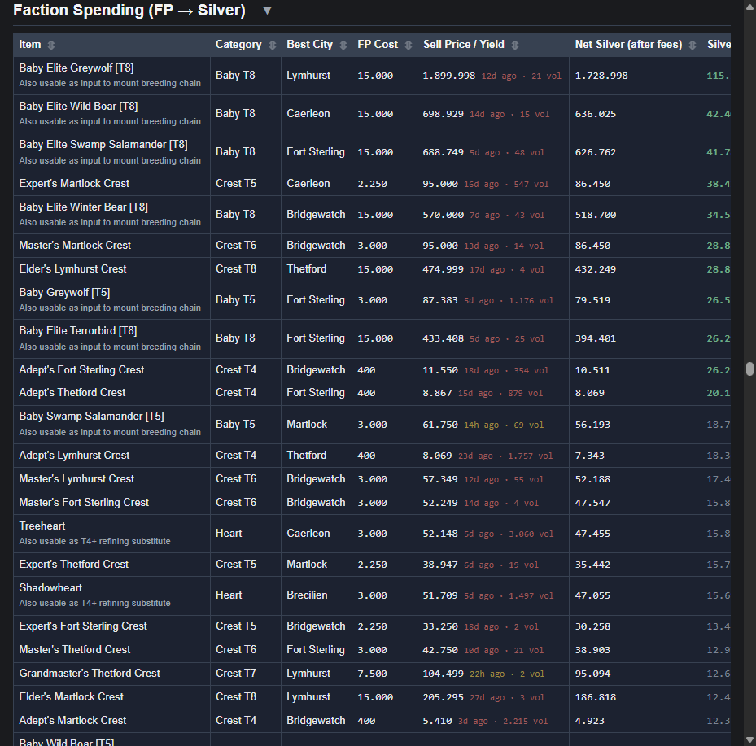
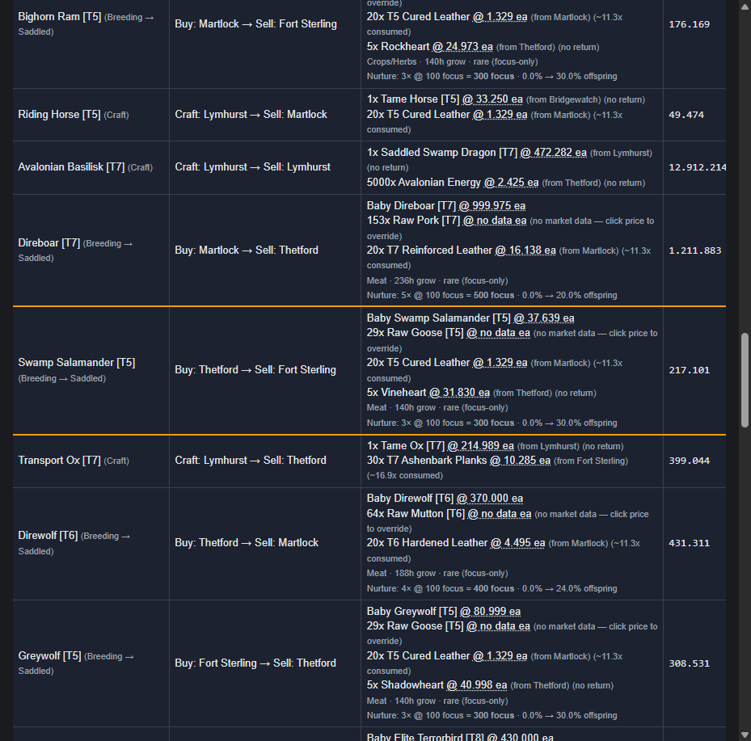
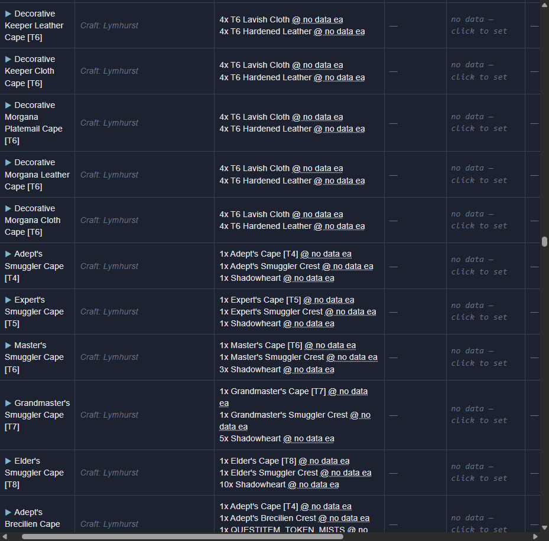

# Albion Market Analyzer

[](https://github.com/ov3rdr1ve/albion-market-analyzer/actions/workflows/ci.yml)
[](LICENSE)

A Windows desktop app that turns Albion Online market prices into decisions:
what to craft, refine, flip, breed, farm or spend Faction Points on, ranked by
silver profit and by profit per focus. Prices come from the public Albion Online
Data Project (AODP) API, from your own manual overrides, or from a passive
capture of the market windows you open in the game.

## Screenshots



*Faction Spending: every way to turn Faction Points or Favor into silver, with
the age and traded volume of each price.*



*Mounts: breeding routes against crafting routes, with the buy and sell city,
the full material list and the focus needed to raise each animal.*



*Crafting Planner: one row per item with its recipe. Cells without a price
read "no data - click to set", so any price can be typed in by hand.*

## Features

Tables are grouped into tabs (see `js/partials/group-*.js`):

- **Market and trading**: Top 10 profit and Top 10 focus boards across every
  scanned table, a Black Market board, a flipping scanner that routes across
  city pairs and quality levels, Saved Trades, Skins Trading, traded volume, and
  a gold price chart with indicators.
- **Crafting and refining**: the Crafting Planner (refine, craft and journal
  steps with return rate and focus), Transport, Consumables and Artifact
  Rolling tables.
- **My Crafting List**: pick rows with "+", get quantities, a combined shopping
  list and a focus-aware profit estimate.
- **Item upgrades**: Enchanting, Transmuting and quality Rerolling.
- **Gathering and production**: Gathering, Farming, Mounts (breeding and
  crafting), Laborers, Journal Filling and Buildings costs.
- **Faction Warfare**: Faction Spending (Faction Points and Favor to silver).
- **Roads of Avalon**: a manual zone directory, portal list, drawn map and route
  planner. Portals are typed in by the player and can be shared with a team.
- **Reference**: city bonuses, black zone bonuses and locations, Brecilien fees.
- **Live market capture** (optional, needs Npcap): fills prices and volumes from
  the markets you open in the game and can contribute them back to AODP.
- **Team sync**: share the Roads map and recent prices through a shared folder
  (for example Dropbox). No server, no account.
- **English and Spanish** UI, a premium account toggle, per-table focus
  specialization settings and a settings export/import bundle.

## Getting started

Requirements: Node.js 24 LTS (the version CI uses) and npm.

```bash
npm install     # installs dependencies, applies patches/, rebuilds `cap` for Electron
npm start       # runs the app
npm test        # node:test suite, no network or game needed
npm run lint    # ESLint
npm run dist    # builds the NSIS installer into dist/ (Windows)
```

The live capture needs Windows and [Npcap](https://npcap.com/). Everything else
works without it: use **Scan Market** to pull AODP prices, or type prices into
any cell. If the native `cap` module cannot be compiled (no C++ toolchain),
`npm install` only warns; lint and tests still run, and
`npm run rebuild:electron` fixes the capture later.

## Tech stack

| Part | Choice |
| --- | --- |
| Shell | Electron `^42` (main process, preload bridge, context-isolated renderer) |
| UI | Plain JavaScript, HTML and CSS: no framework, no bundler |
| Capture | Npcap through the native `cap` `^0.2.1` module |
| Tests | Node's built-in test runner (`node --test`), no live API or database |
| Lint | ESLint `^10` with `@eslint/js` `^10` |
| Packaging | electron-builder `^26` (NSIS), `@electron/rebuild` `^4` |
| CI | GitHub Actions on `windows-latest` (lint and tests) |

## Architecture

The renderer is a set of classic scripts that share globals; the main process
owns files, windows and the capture. Market data flows from the packet tap
through the Photon parser and the market reader into the price stores and,
optionally, the AODP uploader. See [docs/ARCHITECTURE.md](docs/ARCHITECTURE.md)
for the process layout, the script graph, the capture pipeline, persistence,
catalog generation and the testing approach.

## Data sources

- **AODP API** ([albion-online-data.com](https://www.albion-online-data.com/)):
  live prices, price history and volumes.
- **[ao-bin-dumps](https://github.com/ao-data/ao-bin-dumps)**: recipes,
  focus costs, buildings and names. The raw dumps live in `data/dumps/`
  (`items.xml`, `items.json`, `buildings.xml`, `achievements.xml`).
- **Generated catalogs**: `scripts/gen-*.cjs` and `scripts/extract-*.js` turn
  the dumps into `js/` catalogs (item index, Spanish names, item values,
  consumable output, focus costs, journal fame, Roads zones and more). Re-run
  the matching script after refreshing a dump.

Generated and data-only catalogs are exempt from the 800-line file limit that
applies to hand-written code: `js/gear-*.js`, `js/focus-spec-items.js`,
`js/focus-costs.json`, `js/item-index.js`, `js/item-names-es.js`,
`js/i18n-strings-en.js`, `js/data-roads-zones.js`, and the other files with an
`AUTO-GENERATED` header.

## Game terms of service

The live capture is passive and read-only, the same technique the Albion Data
Project client uses: it listens to the game's market network traffic through
Npcap and never writes to the socket. There is no packet injection, no memory
reading, no modification of the game and no automation. See the
[Albion Data Project client FAQ](https://www.albion-online-data.com/client-faq).
This project is not affiliated with Sandbox Interactive or the Albion Data
Project.

## License

[MIT](LICENSE) (c) 2026 Kirill K
