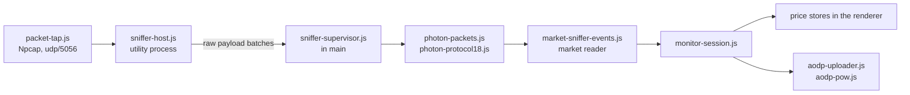

# Architecture

Albion Market Analyzer is an Electron app with no bundler and no framework. The
renderer is plain classic scripts loaded by `index.html`; the main process owns
files, the window and the live capture.

## Processes

| Process | Entry | Role |
| --- | --- | --- |
| Main | `main.js` | Creates the window (`js/app-boot.js`), handles IPC, reads and writes files under `userData`, starts the capture, runs the AODP upload. |
| Preload | `preload.js` | The only bridge. Exposes five objects through `contextBridge` (below). The renderer runs with `contextIsolation: true` and `nodeIntegration: false`. |
| Renderer | `index.html` + `js/*.js` | All tables, calculations and UI. Talks to the main process only through the preload bridges. |
| Capture | `js/sniffer-host.js` | A utility process ("albion-capture") that owns the native `cap` module, so a native fault there cannot take the app down. |

### IPC bridges (`preload.js`)

| Bridge | Channels (`ipcMain.handle` in `main.js`, or pushed from main) |
| --- | --- |
| `marketMonitor` | `monitor:start`, `monitor:stop`, `monitor:status`, `monitor:setUpload`, `monitor:setCity`, `monitor:getAutoStart`, `monitor:setAutoStart`, `monitor:npcap`, `monitor:installNpcap`; pushed: `monitor:prices`, `monitor:own-orders`, `monitor:status`, `monitor:location`, `monitor:stats` |
| `scanPriceStore` | `scanPrices:load`, `scanPrices:save` |
| `capturedPriceStore` | `capturedPrices:load`, `capturedPrices:save` |
| `teamSync` | `sync:getPrefs`, `sync:setPrefs`, `sync:pickFolder`, `sync:readPeers`, `sync:publish` |
| `appZoom` | `app:setZoom` |

`tests/monitor-ipc-contract.test.cjs` parses `preload.js` and `main.js` and
fails if a channel is used on only one side.

## Renderer: a classic-script graph

`index.html` loads about 150 scripts with `<script defer>`. They share one global
scope, so a top-level `function` or `const` in one file is a name every later
file can use. Order in `index.html` is the dependency graph: a catalog or
helper must load before its consumers. `js/catalog-ready.js` and `js/app.js`
(with `js/app-*.js`) run the boot sequence once the catalogs exist.

Two consequences shape the code and the tooling:

- **Shared globals and ESLint.** Cross-file names are declared in
  `eslint.globals.json`, generated by `scripts/gen-eslint-globals.cjs`.
  `eslint.config.cjs` loads that list for `js/**`, so `no-undef` still catches
  typos across files while `no-unused-vars` only checks locals (a top-level
  declaration is a public name).
- **Top-level `const` is not on `globalThis`.** Tests that load a script into a
  `vm` context read such names back explicitly.

### Partials via `document.write`

The markup of each tab group lives in `js/partials/group-*.js`, not in
`index.html`, which keeps `index.html` under the 800-line limit. Each partial is
a non-deferred script that calls `document.write` with its markup, which inserts
the markup at that script tag's position while the parser is still running. The
group is therefore in the DOM before any deferred app script runs. It needs no
`fetch()` or XHR, so it works from `file://` inside Electron, and it needs no
build step. `tests/helpers/page-source.cjs` expands the partial tags so markup
tests see the page as the browser does.

## Live market capture pipeline

The capture is passive and read-only. It listens to the game's UDP traffic and
never writes to a socket.

1. `js/packet-tap.js` opens the network adapter through Npcap and filters the
   game's Photon UDP port. It ranks adapters and confirms the choice by traffic
   rather than trusting the first one listed.
2. `js/sniffer-host.js` runs the tap in the utility process and packs raw
   payloads into batches (`js/sniffer-batch.js`) so a market burst is not
   thousands of IPC hops.
3. `js/sniffer-supervisor.js` in main receives the batches, restarts the child
   if it dies, and exposes the same surface the tap does.
4. `js/photon-packets.js`, `js/photon-protocol18.js` and `js/photon-reader.js`
   decode Photon frames into operations. Every read is bounds-checked, because
   truncated frames are normal.
5. `js/market-sniffer-events.js` turns market operations into order books per
   city; `js/join-location.js` resolves which city the player is in.
6. `js/monitor-session.js` fans one capture out to the app's price map (pushed
   to the renderer as `monitor:prices`) and to the AODP uploader. Its sniffer
   factory and upload function are injected, which is how it is tested.
7. `js/aodp-uploader.js` posts the orders to the Albion Online Data Project,
   including the proof-of-work the public ingest requires (`js/aodp-pow.js`,
   `js/aodp-pow-async.js`). The region follows the game server's IP, not the
   region chosen in the app.
8. In the renderer, `js/market-price-store.js`, `js/captured-prices-store.js`
   and `js/own-orders-store.js` fold captured prices over scanned ones by date
   (a capture wins only where it is newer), and `js/price-book-fallback.js`
   decides what to show when a book is empty.

Without Npcap the pipeline is simply off; the app still works from AODP scans
and manual prices.

## Persistence

| What | Where | Code |
| --- | --- | --- |
| Scanned price bundle | `scan-prices.json` in `userData` | `js/scan-price-file.js`, `js/scan-price-store.js` |
| Captured prices | `captured-prices.json` | `js/captured-price-file.js`, `js/captured-prices-store.js` |
| Monitor preferences | main-side prefs file | `js/monitor-prefs.js` |
| Team sync preferences | `sync-prefs.json` | `js/sync-prefs.js` |
| Team sync data | one file per device in the shared folder | `js/sync-folder.js`, `js/team-sync-payload.js`, `js/team-sync-loop.js` |
| Small UI state, price overrides, craft list, Roads portals | renderer `localStorage` | `js/table-overrides.js`, `js/craft-list-store.js`, `js/data-roads-portals.js` |
| Settings export/import | a JSON bundle | `js/settings-transfer.js` |

Large data goes through the main process to a file because a full scan is
several megabytes, over the `localStorage` quota. The `package.json` `name` and
`build.appId` set the `userData` path and the installer identity, so they must
not change.

## Catalog generation

Game data is not fetched at runtime. Raw dumps from
[ao-bin-dumps](https://github.com/ao-data/ao-bin-dumps) are in `data/dumps/`,
and generators in `scripts/` write the `js/` catalogs:

- `scripts/gen-item-index.cjs`, `gen-item-names-es.cjs`, `gen-item-values.cjs`,
  `gen-item-categories.cjs`, `gen-buildings-catalog.cjs`,
  `gen-craft-journal-fame.cjs`, `gen-focus-spec-nodes.cjs`,
  `gen-roads-zones.cjs`, `gen-skins-catalog.cjs`;
- `scripts/extract-focus-costs.js`, `extract-weights.js`,
  `extract-upgrade-sauces.js`, `extract-consumable-output.cjs`.

Generated files carry an `AUTO-GENERATED` header and are exempt from the
800-line limit and from ESLint; `js/gear-*.js` and `js/focus-spec-items.js` are
likewise data-only. Hand-written code stays under 800 lines per file.

## Internationalization

The authored English stays in the HTML as the fallback. `scripts/gen-i18n-index.cjs`
tags `index.html` and every `js/partials/group-*.js` with `data-i18n` slugs and
writes `js/i18n-strings-en.js`. Spanish is authored by hand in
`js/i18n-strings-es*.js`; missing keys fall back to English. Item names use
`js/item-names-es.js`. The tagger is idempotent: a second run rewrites the
files byte for byte, and `tests/gen-i18n-index.test.cjs` plus a clean
`git status` after `node scripts/gen-i18n-index.cjs` guard that fixed point.

## Testing

`npm test` runs `node --test tests/*.test.cjs` (about 930 cases). Rules:

- **Black-box and simulated.** Tests drive inputs and outputs. They never touch
  the live AODP API, a database or a capture device: the sniffer factory, the
  uploader and the file layer are injected (see
  `tests/monitor-session.test.cjs` and `tests/aodp-pow-async.test.cjs`).
- **Renderer code without a browser.** Plain scripts are loaded into a Node
  `vm` context with a small DOM stub. Tests that grep markup or sources read
  them through `tests/helpers/page-source.cjs` and
  `tests/helpers/app-source.cjs`, so they keep working when a file is split.
- **Generators are checked against the dumps** in `data/dumps/` (for example
  `tests/helpers/items-xml-recipes.cjs`), so a stale catalog fails a test.
- **Lint** is part of CI: `npm run lint` must exit 0.
